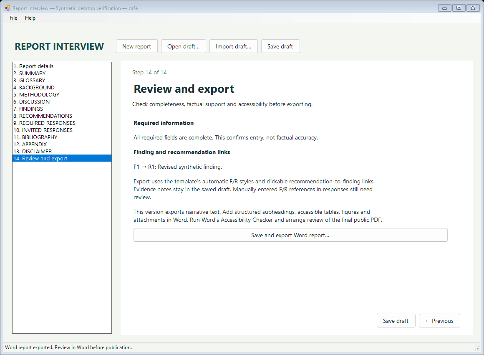

# Civil Grand Jury Report Writer

A local Windows application that guides an author through a civil grand jury report using a revised accessible CGJA Word template. It checks for missing required sections, keeps findings linked to recommendations, saves resumable drafts, and exports a `.docx` using the template’s styles.

**No AI, browser, web server, telemetry or cloud processing is used at runtime.** The application never supplies missing report facts. Its checks test completeness and author verification flags; they do not establish factual truth or legal sufficiency.



## Install or build

Requirements: **64-bit Windows 10 or Windows 11, with .NET Framework 4.8 or later**. Users do not need Go or Python installed.

Download the Windows build from the [Windows build workflow](https://github.com/bizzarri/Civil-Grand-Jury-Report-Writer/actions/workflows/windows.yml). Open a successful run and download its `ReportInterview-Windows-x64` artifact. Extract it and run `ReportInterview-2.0.0-x64.msi`, then open **Report Interview** from the Start menu. GitHub may require sign-in to download workflow artifacts. The installer is unsigned.

For maintainers, the same artifact contains a portable ZIP. Extract the entire ZIP and open `ReportInterview.exe`; keep its companion files together. Build instructions are below.

The MSI installs for the current account, creates a Start menu shortcut and an entry in Windows Installed apps, and provides repair/removal when reopened. Uninstalling retains drafts and exported reports. Application files are installed at `%LOCALAPPDATA%\Programs\ReportInterview`; drafts are stored separately.

## Write a report

1. Choose **New report** and enter approved title, county, jury term and release date.
2. Follow the sections in the left navigation. Each section includes its original template guidance. Optional empty sections are omitted from export.
3. Enter findings with evidence references, then explicitly verify them. Editing a finding or its evidence resets its verification checkbox. Evidence notes stay in the draft and are not published.
4. Enter recommendations with responsible entities, actions and timing; link them to supporting findings. A finding cannot be removed while recommendations reference it.
5. Open **Review and export**. Missing required entries are listed; double-click one to return to its section. Export becomes available when the required information is complete.

Work autosaves after a short pause and before section changes. Ctrl+S saves explicitly; Ctrl+O opens a saved draft; Ctrl+N starts a report; Ctrl+E exports Word. Revision checks protect against silently overwriting a draft changed on disk.

## Continue a draft from the browser version

Choose **File → Import existing draft**, then select the `.json` file from the old application's `data` folder. The import makes a new copy and preserves text, evidence notes, verification flags and finding/recommendation links. The original file is unchanged. A Word export is not a resumable draft; use its source JSON.

Desktop drafts live at `%LOCALAPPDATA%\ReportInterview\Drafts`. Use **File → Open drafts folder** to find and back them up. Files contain plaintext report content and evidence notes. Keep them on approved storage; do not attach actual reports, drafts, interview identities or confidential evidence to public issues or pull requests.

## Word export and accessibility

The engine embeds the exact revised accessible template used by this project. It preserves all untouched Word package parts byte-for-byte, retains the template’s named styles and separate automatic F/R numbering, and creates recommendation hyperlinks to finding bookmarks. Only the report body and document title metadata are changed. Author instructions, unused placeholders, sample tables/images and empty optional sections are omitted.

This version supports **narrative text and structured findings/recommendations**. Add nested discussion headings, accessible tables, figures, attachments and automatic contents in Word after export. Required/invited response wording, recipients, deadlines and manually entered F/R references need author review; legal requirements are not calculated automatically.

Run Word’s Accessibility Checker and arrange review of the exact final public PDF with the responsible court. Preserving source features does not establish accessibility conformance. See [template provenance](NOTICE.md) and [validation limits](docs/VALIDATION.md).

## Build from source

Build dependencies: Go 1.22 or later, the Windows .NET Framework C# compiler, and **Python 3.11** with standard `msilib`. Python is used only to package and verify the MSI; it is not part of the installed application. Python 3.13+ removed `msilib` and cannot run these packaging scripts.

```powershell
git clone https://github.com/bizzarri/Civil-Grand-Jury-Report-Writer.git
cd Civil-Grand-Jury-Report-Writer
.\source\build.ps1 -PythonExecutable 'C:\Path\To\Python311\python.exe'
```

Outputs are `app/ReportInterview.exe`, its companion engine/configuration/documentation files, and `dist/ReportInterview-2.0.0-x64.msi` with a SHA-256 file. An ordinary Go toolchain and Python are sufficient; no extra Go, Python or NuGet packages are required.

```powershell
# Engine tests
Push-Location .\source\engine
go test ./...
Pop-Location

# Native-control test with synthetic data only; use a fresh scratch folder
$qa = Join-Path $PWD 'work\native-test'
$p = Start-Process .\app\ReportInterview.exe -ArgumentList @('--self-test', ('"' + $qa + '"')) -Wait -PassThru
if ($p.ExitCode -ne 0) { throw 'Native test failed; inspect work\native-test\FAIL.txt' }

# Read-only MSI verification and actual cabinet/payload comparison
python .\source\verify_msi.py .\work\msi-test
```

The Windows workflow builds the application and installer, runs the engine/native tests, verifies the MSI payload, and uploads the installer, checksum, portable ZIP and validation artifacts. It does not claim a completed install/repair/uninstall test on a physical Windows desktop.

## Structure and contributions

- `source/Desktop.cs`: native C# Windows Forms interface and local engine client.
- `source/engine/`: Go draft store, template reader, validation and Word exporter. Commands use stdin/stdout; there is no network listener.
- `source/build.ps1`, `source/build_msi.py`: application and per-user MSI builds.
- `source/verify_msi.py`: package/database/payload verification without installation.
- `source/engine/template/revised.docx`: supplied authoring template; its hash binds drafts to this version.

See [contributing](CONTRIBUTING.md), [security and private data](SECURITY.md), and the [changelog](CHANGELOG.md). AI-assisted coding was used to develop the project; no AI is integrated into its operation. Optional AI conversation is deferred and would require a separate, explicit design and approval process.

Original application code is [MIT licensed](LICENSE). See [NOTICE.md](NOTICE.md) for the separately attributed template material; the project does not claim CGJA endorsement.
